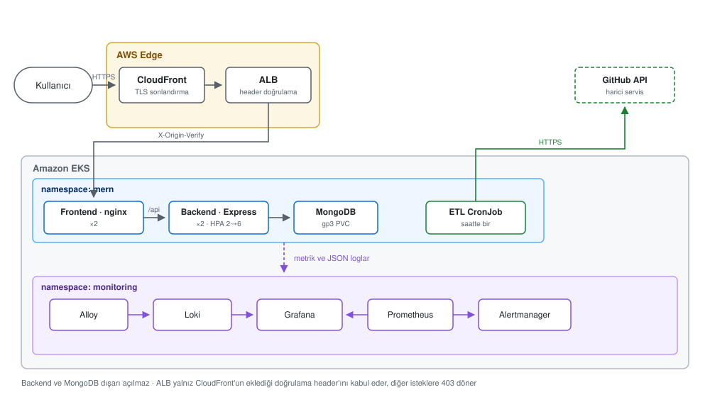

# Mimari

Uygulama React frontend, Express backend, MongoDB ve saatlik Python ETL görevinden
oluşur. Tüm bileşenler AWS EKS üzerinde çalışır.

## Genel görünüm

Diyagram [docs/mimari.svg](docs/mimari.svg) dosyasındadır ve README'nin başında da
aynısı kullanılır; mimari değişikliklerinde yalnız bu dosya güncellenir.

EKS node'ları iki availability zone'daki private subnet'lerde çalışır. ALB public
subnet'lerdedir; dışarı çıkış için tek NAT Gateway kullanılır.

## İstek akışı

1. CloudFront HTTP trafiğini HTTPS'e yönlendirir ve origin isteğine özel bir header ekler.
2. ALB yalnız bu header'ı taşıyan istekleri kabul eder; doğrudan erişim `403` döner.
3. nginx React dosyalarını sunar, `/api` isteklerini backend Service'e iletir.
4. Backend, Kubernetes Secret içindeki bağlantı bilgisiyle MongoDB'ye erişir.

Backend ve MongoDB cluster dışına açılmaz. Tek public giriş noktası kullanıldığı için
ayrı bir CORS yapılandırmasına ihtiyaç yoktur.

## Bileşenler

- **Frontend:** nginx üzerinde port 8080'den sunulur. İki replica, sağlık kontrolleri
  ve PodDisruptionBudget ile çalışır.
- **Backend:** port 5050'de çalışır. Liveness yalnız süreci, readiness MongoDB
  bağlantısını kontrol eder. İki replica ile başlar ve HPA ile altıya çıkabilir.
- **MongoDB:** Tek replica StatefulSet ve 10 GiB gp3 PVC kullanır. Authentication
  açıktır ve yalnız cluster içinden erişilir.
- **ETL:** `0 * * * *` zamanlamalı CronJob'dır. `runner.py` çıktıyı JSON loga çevirir;
  65 dakika başarılı koşu olmazsa alarm tetiklenir.

## CI/CD ve monitoring

MERN pipeline'ı build, Cypress, Trivy, ECR push, EKS rollout ve smoke test adımlarını
çalıştırır. ETL pipeline'ı lint ve taramadan sonra CronJob imajını günceller ve geçici
bir Job ile doğrular. AWS erişimi kalıcı anahtar yerine OIDC ile sağlanır.

Prometheus metrikleri, Alloy ise uygulama loglarını toplar. Loglar Loki'de saklanır ve
Grafana'dan görüntülenir. Alertmanager servis, ETL, disk ve node sorunlarını izler.
Grafana public değildir; port-forward ile açılır.

## Güvenlik ve sınırlar

- Container'lar non-root ve read-only filesystem ile çalışır.
- Default-deny NetworkPolicy uygulanır.
- Secret değerleri Git'te tutulmaz; Terraform tarafından üretilir.
- ECR tag'leri immutable'dır ve imajlar push öncesi taranır.
- CI rolü yalnız `mern` namespace'inde gerekli kaynakları güncelleyebilir.

Bu yapı değerlendirme ortamına göre tasarlanmıştır. MongoDB tek replica, node sayısı
sabit ve PVC'ler AZ'ye bağlıdır. Production ortamında yönetilen veya çok replikalı bir
veritabanı, node autoscaling, Secrets Manager ve özel domain eklenmelidir.
