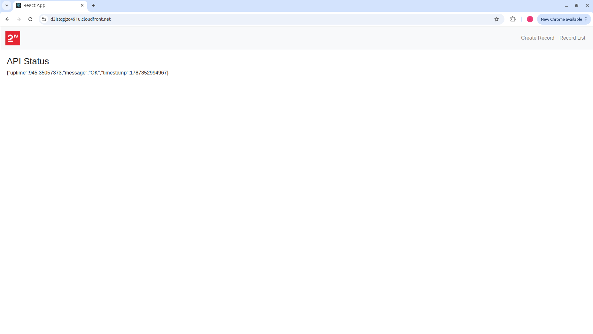
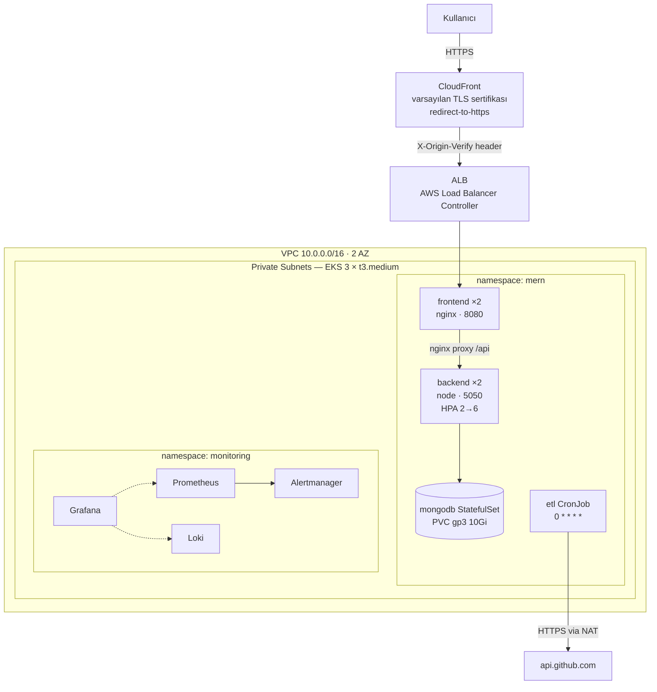
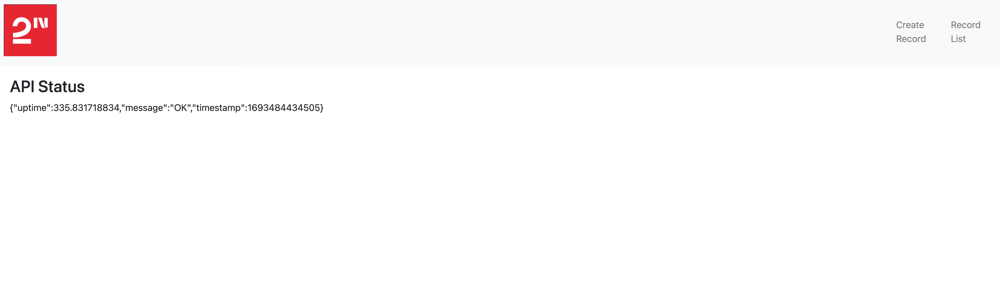

# DevOps Case — MERN Stack + Python ETL, AWS EKS üzerinde

Bir MERN yığını (React · Express · MongoDB) ve bir Python ETL yardımcı programı,
AWS üzerinde **Kubernetes (EKS)** ile konteynerleştirilmiş, orkestre edilmiş,
CI/CD ile dağıtılan ve izlenen bir sistem olarak kuruldu.

**Canlı uygulama:** https://d3istqpjzc491u.cloudfront.net



| | |
|---|---|
| Bulut / bölge | AWS · `eu-central-1` |
| Orkestrasyon | EKS 1.34 · managed node group 3 × `t3.medium` |
| IaC | Terraform 1.15 (S3 remote state, native lockfile) |
| CI/CD | GitHub Actions · OIDC federated role (uzun ömürlü anahtar yok) |
| Giriş noktası | CloudFront (HTTPS) → ALB → nginx → backend |
| Gözlemlenebilirlik | Prometheus · Loki · Grafana Alloy · Alertmanager |

---

## 1. Kabul kriterleri — ve karşılandığının kanıtı

Case ile birlikte verilen dört kriter. Her satır **çalışan sistem üzerinde** doğrulandı;
komutları kendiniz çalıştırabilirsiniz.

| # | Kriter | Durum | Doğrulama |
|---|---|---|---|
| 1 | MongoDB bağlı olmalı | ✅ | `curl https://d3istqpjzc491u.cloudfront.net/api/healthcheck/ready` → `{"status":"ready","mongo":"up"}` |
| 2 | Tüm endpoint'ler çalışmalı | ✅ | `POST /api/record` → 201 · `GET` → 200 · `GET /:id` → 200 · `PATCH` → 200 · `DELETE` → 200 · silinen kayıt → **404** |
| 3 | Tüm sayfalar çalışmalı | ✅ | `/` · `/records` · `/create` · `/edit/:id` — SPA fallback nginx'te, Cypress e2e 3/3 geçiyor |
| 4 | `ETL.py` saatte 1 çalışmalı | ✅ | `CronJob` `0 * * * *`; ardışık koşular `succeeded` — `kubectl -n mern get jobs` |

> Kriter 4'ün sessizce bozulmasına karşı ayrıca bir alarm var: **`ETLJobMissing`**
> 65 dakikadır başarılı koşu yoksa *veya hiç olmamışsa* ateşler. Bir web servisi
> çökerse kullanıcı fark eder; bir CronJob susarsa kimse fark etmez.

---

## 2. Mimari



**Tek giriş noktası vardır.** Backend cluster dışına açılmaz; `/api` önekini nginx
soyup backend'e iletir. Böylece tek origin, tek sertifika, CORS yok.
ALB'ye doğrudan erişim `403` döner — TLS atlatılamaz.

Ayrıntılı tasarım ve karar gerekçeleri: **[MIMARI.md](MIMARI.md)**

---

## 3. Sıfırdan kurulum

Ön koşullar: `terraform 1.15+`, `kubectl 1.34`, `helm 3.21`, `aws` CLI (yapılandırılmış),
`docker`. Toplam süre ~35 dakika (EKS'in kendisi ~15 dk).

```bash
# 0) Lokalde çalıştığını görmek (AWS gerekmez)
docker compose up -d
docker compose run --rm cypress        # e2e 3/3 geçmeli
# http://localhost:8080

# 1) Remote state bucket'ı (bir kez)
cd terraform/bootstrap
terraform init && terraform apply
terraform output backend_config        # çıktıyı envs/prod/backend.tf'e yazın

# 2) Ana altyapı — VPC, EKS, ECR, IAM/OIDC, ALB Controller, addon'lar,
#    namespace + secret'lar ve monitoring yığını
cd ../envs/prod
terraform init
terraform apply                        # ~20 dk

aws eks update-kubeconfig --name $(terraform output -raw cluster_name) --region eu-central-1
kubectl get nodes                      # 3 node Ready

# 3) İlk imajları elle push edin (pipeline henüz tag bilmiyor)
aws ecr get-login-password --region eu-central-1 \
  | docker login --username AWS --password-stdin $(terraform output -raw ecr_registry_url)
# docker build + push → k8s/overlays/prod/kustomization.yaml'daki tag'leri güncelleyin

# 4) Uygulama manifestleri
#    origin-verify sırrı git'te YOKTUR; placeholder apply anında doldurulur
kubectl kustomize k8s/overlays/prod \
  | sed "s/__ORIGIN_VERIFY__/$(terraform output -raw origin_verify_secret)/" \
  | kubectl apply -f -
kubectl -n mern rollout status deploy/backend deploy/frontend

# 5) CloudFront — ALB doğduktan SONRA
cd ../edge
terraform init && terraform apply
terraform output app_url               # public HTTPS adresiniz
```

> **Sıra zorunludur.** ALB'yi Terraform yaratmaz; Ingress'e bakarak AWS Load Balancer
> Controller yaratır. `envs/edge` erken çalıştırılırsa origin bulunamaz ve plan
> bilerek hata verir.

**Kapatma:**

```bash
kubectl -n monitoring delete pvc --all   # ÖNCE: yoksa EBS volume'ları VPC destroy'unu asar
cd terraform/envs/edge && terraform destroy
cd ../prod && terraform destroy
```

Terraform ayrıntıları, maliyet tablosu ve tuzaklar: **[terraform/README.md](terraform/README.md)**

---

## 4. Repo yapısı

```
docker/                     3 Dockerfile (client, server, etl) + nginx template
docker-compose.yml          lokal uçtan uca: mongo + backend + frontend + cypress
k8s/base/                   13 manifest — sts, deployment, svc, hpa, pdb, ingress,
                            cronjob, networkpolicy  (namespace ve secret'lar Terraform'da)
k8s/overlays/prod/          kustomization (namespace, imaj tag'leri) + ingress patch
terraform/bootstrap/        S3 state bucket
terraform/envs/prod/        VPC, EKS, ECR, IAM/OIDC, addon'lar, monitoring
terraform/envs/edge/        CloudFront
terraform/modules/          ecr, github-oidc, edge (upstream karşılığı olmayanlar)
monitoring/                 3 chart values + alert kuralları + Grafana dashboard'ları
.github/workflows/          mern.yml · etl.yml
docs/                       KARSILASILAN_ZORLUKLAR.md · screenshots/
```

---

## 5. CI/CD

İki bağımsız pipeline, ikisi de canlı koştu.

**`mern.yml`** — tetik: `mern-project/**`, ilgili Dockerfile'lar
1. Lint + build + unit test
2. `docker compose up` → **Cypress e2e** (başarısızsa video/screenshot artifact)
3. Buildx → **Trivy** (`HIGH,CRITICAL`, `--ignore-unfixed`, `exit-code 1`) → ECR push, tag = commit SHA
4. `kubectl set image` → `rollout status` → smoke → **başarısızsa otomatik `rollout undo`**

**`etl.yml`** — tetik: `python-project/**`: `ruff` → build → Trivy → push →
CronJob imaj patch'i → **doğrulama Job'ı** (`--from=cronjob/etl`) → başarısızsa geri patch.

Üç tasarım kararı:
- **Tarama push'tan önce.** İmaj önce yalnız yerel daemon'a alınır (`load: true`);
  taranmamış imaj registry'ye hiç girmez.
- **CI tam `apply` yapmaz, yalnız imaj tag'ini değiştirir.** Bu sayede cluster
  yetkisi namespace-scoped 5 kurala iner (Secret okuma yok) ve origin-verify sırrı
  pipeline'a hiç girmez. Manifest *yapısı* değişirse dağıtım elle apply edilir.
- **Hiç GitHub secret'ı yok.** AWS erişimi OIDC ile; workflow'lar yalnız `vars.*` okur.

Kurulum için gereken repo *variables*: `AWS_ROLE_ARN`, `ECR_REGISTRY`,
`EKS_CLUSTER_NAME`, `PUBLIC_URL` (dördü de Terraform çıktısı) + `prod` Environment.

---

## 6. Gözlemlenebilirlik

**Loglar** — uygulamalar stdout'a JSON yazar (backend `pino`, ETL `runner.py`);
Grafana Alloy toplar → Loki → Grafana. Retention 14 gün.
Backend istek logunda `authorization`, `cookie`, `set-cookie` **maskelidir**;
`/healthcheck` probe'ları bilerek loglanmaz (gerçek trafiği boğar).

**Metrikler** — kube-prometheus-stack (node-exporter, kube-state-metrics).

**Dayanıklılık — yapılandırma değil, ölçüm:**

| Senaryo | Ölçülen sonuç |
|---|---|
| Pod silindi | **80/80 istek 200** — otomatik yeniden yaratma, kesinti yok |
| Node drain edildi | **110/110 istek 200** — pod'lar kalan node'lara taşındı |

> İlk drain testi **8 başarısız istek** (502 + timeout) gösterdi: pod, ALB hedef
> kaydı silinmeden ölüyordu. `preStop` hook'ları ve `deregistration_delay`
> ayarıyla kapatıldı, test tekrarlandı ve kesinti sıfırlandı
> ([madde 53](docs/KARSILASILAN_ZORLUKLAR.md)). Test edilmeseydi bu, teslimde
> değil gerçek bir bakım penceresinde ortaya çıkardı.

**Alarmlar** — 9 kural: `PodCrashLooping` · `BackendNotReady` · `FrontendNotReady` ·
`MongoDiskFilling` · **`ETLJobMissing`** · `ETLJobFailed` · `NodeNotReady` ·
`NodeMemoryPressure` · `NodeDiskPressure`.

> İki kuralda `absent(...)` **zorunludur**: tüm pod'lar yok olduğunda ya da CronJob
> hiç çalışmadığında zaman serisi kaybolur ve `== 0` biçimindeki bir ifade hiç
> değerlendirilmez — alarm sessizce ateşlenmez. Bu güvenlik ağı gerçek bir hatayı
> yakaladı: bir kural yanlış container adıyla yazılmıştı ve `absent()` olmasaydı
> "çalışıyor" sanılacaktı ([madde 50](docs/KARSILASILAN_ZORLUKLAR.md)).

**Erişim** — Grafana bilinçli olarak dışarı açılmaz (ikinci bir public giriş,
ALB kısıtını delerdi):

```bash
kubectl -n monitoring port-forward svc/kube-prometheus-stack-grafana 3000:80
terraform -chdir=terraform/envs/prod output -raw grafana_admin_password
```

Alertmanager'a Slack webhook'u bağlamak için `TF_VAR_slack_webhook_url` verilir;
boşken tüm alarmlar `null` receiver'a düşer (webhook URL'i git'e girmez).

---

## 7. Güvenlik

11 maddelik kontrol listesinin tamamı **ölçülerek** kapatıldı — komutlar ve çıktıları
[docs/KARSILASILAN_ZORLUKLAR.md](docs/KARSILASILAN_ZORLUKLAR.md) → *Aşama 7*.

- Git'te düz secret yok; parolalar Terraform `random_password` → K8s Secret
- Tüm uygulama container'ları non-root, `readOnlyRootFilesystem`, `drop: ALL`, `seccompProfile`
- **Default-deny NetworkPolicy** — test pod'uyla doğrulandı: mongodb ve backend'e erişim engellendi
- MongoDB headless ClusterIP, dışarı kapalı, auth açık (kimliksiz sorgu reddediliyor)
- CloudFront'ta TLS zorunlu (`http` → 301); **ALB'ye doğrudan erişim → 403**
- IRSA ile pod bazlı en az yetki; node role'de yalnız 3 AWS yönetimli politika
- ECR `scanOnPush` + **`IMMUTABLE`** (push edilmiş tag'in içeriği değişemez)
- GitHub Actions OIDC; uzun ömürlü AWS anahtarı yok
- Root hesapta MFA, 40 USD billing budget, Dependabot açık

---

## 8. Ekran görüntüleri

Tümü [docs/screenshots/](docs/screenshots/) altında; her birinde tarayıcının adres
çubuğundaki **public HTTPS adresi** görünür.

| | |
|---|---|
| [Ana sayfa](docs/screenshots/01-frontend-anasayfa.png) · [Kayıt listesi](docs/screenshots/02-frontend-kayit-listesi.png) · [Kayıt oluşturma](docs/screenshots/03-frontend-kayit-olusturma.png) | Frontend sayfaları |
| [`/api/record`](docs/screenshots/04-api-record-json.png) · [`/api/healthcheck/ready`](docs/screenshots/05-api-healthcheck-ready.png) | Backend API |
| [Pod'lar](docs/screenshots/06-kubectl-get-pods.png) · [CronJob geçmişi](docs/screenshots/07-cronjob-job-gecmisi.png) | Kubernetes |
| [MERN dashboard](docs/screenshots/08-grafana-mern-servis-durumu.png) · [ETL dashboard + loglar](docs/screenshots/09-grafana-etl-cronjob.png) · [Firing alert](docs/screenshots/10-alertmanager-firing-alert.png) | Gözlemlenebilirlik |
| [Yeşil pipeline](docs/screenshots/11-github-actions-pipeline.png) · [ECR imajları](docs/screenshots/12-ecr-imajlar.png) | CI/CD |

---

## 9. Bilinçli sınırlar ve prod'a geçiş yolu

3 günlük süre ve tek kişilik ekip gerçeğiyle aşağıdakiler kapsam dışı bırakıldı.
Her biri bilinçli bir kesimdir, unutulmuş bir eksik değil.

| Sınır | Bugünkü çözüm | Prod'a geçiş yolu |
|---|---|---|
| MongoDB tek replica | StatefulSet + gp3 PVC | 3 node'lu ReplicaSet ya da DocumentDB |
| Secret'lar K8s Secret'ta | Terraform `random_password` (git'te düz secret yok) | External Secrets Operator + Secrets Manager |
| Kayıtlı domain yok | CloudFront varsayılan sertifikası | Route53 + ACM + ExternalDNS |
| Sabit 3 node | HPA 2→6 (backend) | Cluster Autoscaler / Karpenter |
| Backend'de `/metrics` yok | kube-state-metrics üzerinden pod metrikleri | `prom-client` ile uygulama metrikleri |
| Alloy tek replica | API tabanlı log toplama, çoğaltma yok | Alloy clustering ya da DaemonSet + `loki.source.file` |
| **AZ kaybı kurtarılamaz** — EBS PVC'si AZ'ye bağlı | Node kaybı atlatılıyor (drain testiyle ölçüldü); AZ kaybında MongoDB ve Prometheus geri gelemez | AZ başına ≥2 node + MongoDB ReplicaSet (her replica ayrı AZ) ya da DocumentDB/EFS |
| ALB 5xx alarmı yok | `BackendNotReady` + `PodCrashLooping` | CloudWatch exporter ya da metric-math alarmı |

---

## 10. Dokümanlar

| Doküman | İçerik |
|---|---|
| **[MIMARI.md](MIMARI.md)** | Mimari kararlar (ADR), bileşen tasarımı, istek akışı |
| **[docs/KARSILASILAN_ZORLUKLAR.md](docs/KARSILASILAN_ZORLUKLAR.md)** | Karşılaşılan 52 sorun, kök nedenleri, çözümleri ve doğrulama kanıtları |
| **[PROJE_PLANI.md](PROJE_PLANI.md)** | Aşama planı, kapsam kararları, kontrol listeleri |
| **[terraform/README.md](terraform/README.md)** | Stack sırası, maliyet, Terraform tuzakları |

---

<details>
<summary><b>Case ile birlikte verilen orijinal README</b></summary>



### Mern Stack project — `cd mern-project`

Acceptance Criteria:
1. MongoDB should connected
2. All endpoints should work
3. All pages should work

### Python project — `cd python-project`

Acceptance Criteria:
1. ETL.py file should run every 1 hour

</details>
